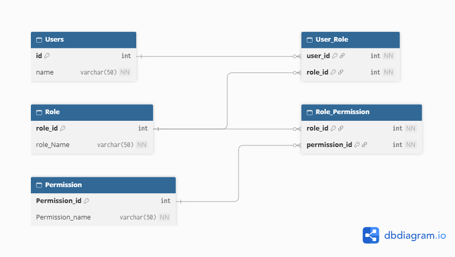

# Role based access 

 
 
1 .what our subsystem does ? :

    to allow specifict user to use specific resource by giving them role and permissions , 
    Restriciting un authorised access 

2 . table by table explanation :
    
    User - stores user name and unique user id which act as primary key 

    Role - stores unique role id and name of role
    
    Permission - stores unique permission id and permission name

    User_Role - Join table used to represent M:M relation ship between user and role 

    Role_permission - Join table used to represent M:M relation ship between role and permission table

3 . relationship :

    Foreign key in user_Role is used to make M:M relation ship between user and role 
    and which is same in role_permission table

4 . design choice :

    
    Design Choice: We opted for explicit normalized junction tables (User_Role and Role_Permission) instead of using PostgreSQL array columns 

    Alternative Rejected: Storing roles or permission strings directly inside array columns on the Users and Role tables.

    why : storing multiple roles in a string will have poor quering , where if we stored as a seperate user to role pair it is efficient to queiry 

5 . indexing :

    indexed all the key in both the join tabe , because it is used as a composite key in future .
